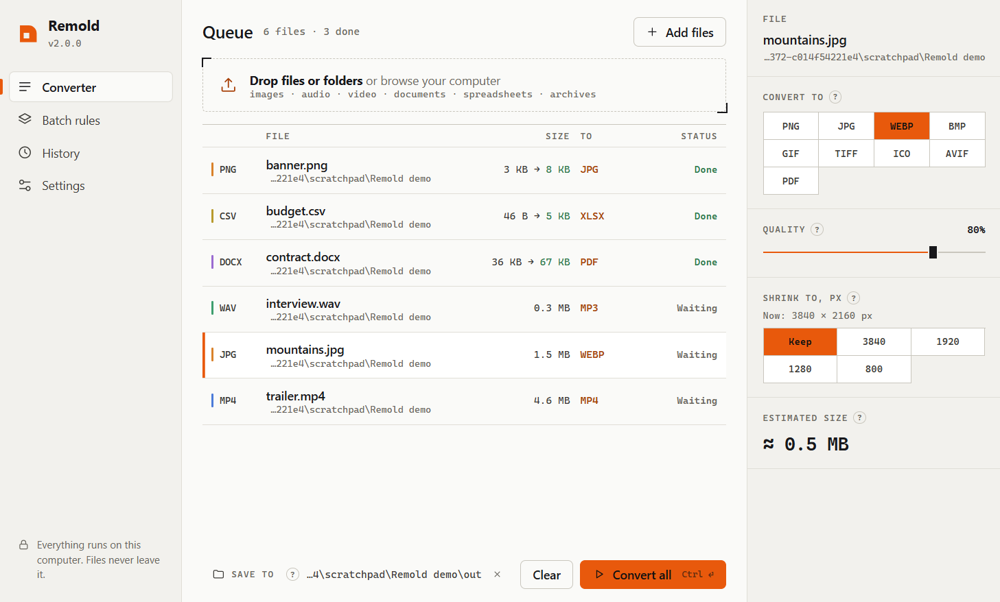

# Remold

**A fast, private file converter for Windows** — images, audio, video, documents, spreadsheets and archives.
Drop files in, pick a format, done. Everything runs locally; nothing is uploaded anywhere.

[Українська версія](README.uk.md)



## Features

- **Many formats in one place**

  | Type | From | To |
  |---|---|---|
  | Images | png, jpg, webp, avif, heic/heif, gif, bmp, tiff, ico, tga, ppm | png, jpg, webp, avif, gif, bmp, tiff, ico, pdf |
  | Audio | mp3, wav, flac, ogg, m4a, aac, opus, wma, aiff, amr, ac3, mka | mp3, wav, flac, ogg, m4a, opus, aac, aiff, wma |
  | Video | mp4, mkv, mov, webm, avi, flv, wmv, m4v, mpeg, 3gp, ts, ogv | mp4, mkv, mov, webm, avi, **gif**, or audio only |
  | Documents | pdf, docx, txt, md, html | pdf, docx, txt, md, html; PDF pages → png/jpg |
  | Spreadsheets | csv, tsv, json, xlsx, xml | csv, tsv, json, xlsx, xml, html, md |
  | Archives | zip, tar, tar.gz, tar.bz2, tar.xz | zip, tar, tar.gz, tar.bz2, tar.xz |

- **Real size estimates** — Remold test-compresses the file with your current settings before you convert
  (images in memory, a 3-second clip for video), so the number you see is close to the real result.
- **Batch conversion** with per-type rules, parallel workers, progress and cancel.
- **Explorer integration** — right-click files → *Convert to* → format. The result lands next to the original.
- **Automatic updates** from GitHub Releases (or `git pull` when running from source), can be turned off.
- **Ukrainian and English** interface, light and dark themes.
- ffmpeg is bundled — nothing else to install.

## Download

Grab `Remold-windows-x64.zip` from the [latest release](../../releases/latest), unzip it anywhere
and run `Remold.exe`. Keep the `_internal` folder next to the exe. Requires Windows 10/11
(uses the Edge WebView2 runtime, which is already part of Windows).

## Run from source

```bash
git clone https://github.com/DimaN221221/remold.git
```

```bash
pip install -r requirements.txt
```

```bash
python main.py
```

Or double-click `Remold.bat`. A source checkout updates itself with `git pull --ff-only`
when automatic updates are on.

## Command line

```bash
python main.py video.mp4 -t mp3
```

```bash
python main.py photo1.heic photo2.heic -t jpg --quality 85 -o converted
```

```bash
python main.py --formats document.pdf
```

The built `Remold.exe` accepts the same arguments. Other options: `--bitrate 320k`,
`--video-quality high|medium|low`, `--height 720`, `--register-menu`, `--unregister-menu`.

## Building and releasing

```bash
pip install pyinstaller
```

```bash
python build.py --zip
```

This produces `dist/Remold/Remold.exe` plus `dist/Remold-windows-x64.zip` and its `.sha256`.

To publish a release, bump `__version__` in `version.py`, commit, then push a matching tag
(for example `v2.1.0`). The [release workflow](.github/workflows/release.yml) builds the app on
GitHub Actions and attaches the zip and checksum to the release. The in-app updater downloads
that zip, verifies the SHA-256 and installs it when the app closes.

If you fork the project, change `REPO` in `version.py` so updates come from your repository.

## Project layout

```
main.py          entry point (window or command line)
desktop.py       app backend for the window: queue, workers, settings, updates
webui/           interface (HTML/CSS/JS), i18n.js holds the UA/EN strings
core.py          format registry, type detection, output naming, dispatcher
converters/      images (Pillow), media (ffmpeg), documents (PyMuPDF, python-docx),
                 data (csv/json/xlsx/xml), archives (zip/tar)
updater.py       GitHub Releases / git updates
shell_menu.py    Explorer context menu (HKCU, no admin rights needed)
quick.py         quick conversion from the context menu with a small progress window
store.py         settings and history in %APPDATA%\Remold
i18n.py          strings used by the Python side (menu, progress window, errors)
version.py       app name, version, update repository
```

## Notes

- Document conversion keeps text and basic formatting (headings, lists, bold/italic); images and complex
  layout are not carried over. PDF → DOCX extracts text without the original layout.
- On Windows 11 the Explorer item is under *Show more options* (or Shift + right-click).
