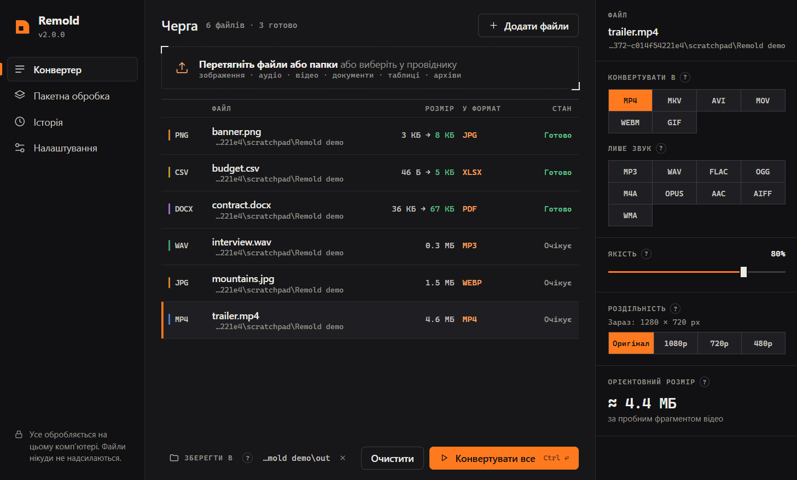

# Remold

**Швидкий і приватний конвертер файлів для Windows:** зображення, аудіо, відео, документи, таблиці та архіви.
Перетягніть файли, виберіть формат, готово. Усе обробляється на вашому комп'ютері, нічого нікуди не надсилається.

[English version](README.md)

## Можливості

- **Багато форматів в одному місці**

  | Тип | З | У |
  |---|---|---|
  | Зображення | png, jpg, webp, avif, heic/heif, gif, bmp, tiff, ico, tga, ppm | png, jpg, webp, avif, gif, bmp, tiff, ico, pdf |
  | Аудіо | mp3, wav, flac, ogg, m4a, aac, opus, wma, aiff, amr, ac3, mka | mp3, wav, flac, ogg, m4a, opus, aac, aiff, wma |
  | Відео | mp4, mkv, mov, webm, avi, flv, wmv, m4v, mpeg, 3gp, ts, ogv | mp4, mkv, mov, webm, avi, **gif** або лише звук |
  | Документи | pdf, docx, txt, md, html | pdf, docx, txt, md, html; сторінки PDF → png/jpg |
  | Таблиці | csv, tsv, json, xlsx, xml | csv, tsv, json, xlsx, xml, html, md |
  | Архіви | zip, tar, tar.gz, tar.bz2, tar.xz | zip, tar, tar.gz, tar.bz2, tar.xz |

- **Розмір відомий ще до конвертації.** Remold спершу пробно стискає файл з вашими налаштуваннями,
  тож оцінка розміру близька до реального результату.
- **Багато файлів за раз.** Задайте формат за замовчуванням для кожного типу файлів і конвертуйте всю чергу одним кліком.
  Видно прогрес, процес можна зупинити.
- **Просто з провідника.** Правий клік на файлах → «Конвертувати в» → формат. Результат з'являється поруч з оригіналом.
- **Автоматичні оновлення**, які можна вимкнути.
- Інтерфейс **українською та англійською**, світла й темна теми.
- Усе потрібне вже всередині, додаткові програми встановлювати не треба.

## Завантаження й встановлення

1. Завантажте [Remold-windows-x64.zip](https://github.com/DimaN221221/remold/releases/latest/download/Remold-windows-x64.zip).
2. Розпакуйте в будь-яку зручну папку (наприклад, «Документи\Remold»).
3. Запустіть `Remold.exe`. Папка `_internal` має лежати поруч із ним, без неї програма не працює.

Потрібна Windows 10 або 11 (64-бітна).
Якщо Windows покаже «Windows захистила ваш ПК», натисніть **Докладніше → Усе одно запустити**. Попередження з'являється
через те, що програму не підписано платним сертифікатом.

Усі версії та списки змін є на сторінці [Releases](https://github.com/DimaN221221/remold/releases).

## Як користуватися

1. Перетягніть у вікно файли або цілі папки (чи натисніть **Додати файли**).
2. Клікніть файл у черзі, щоб вибрати формат і якість. Оцінка розміру оновлюється одразу.
3. Виберіть, куди зберегти: поруч з оригіналами або в окрему папку.
4. Натисніть **Конвертувати все**. Оригінали ніколи не змінюються.

Інші екрани:

- **Пакетна обробка**: формат за замовчуванням для кожного типу файлів, папка для результатів і шаблон назви файлу.
- **Історія**: усе, що ви конвертували. Клік по рядку відкриває файл у провіднику.
- **Налаштування**: мова, тема, пункт у меню провідника й оновлення.

### З провідника

Увімкніть **Меню провідника** в Налаштуваннях. Потім клацніть правою кнопкою на одному чи кількох файлах →
**Конвертувати в** → формат. Невелике вікно покаже прогрес, а результат з'явиться в тій самій папці.
У Windows 11 цей пункт знаходиться в «Показати додаткові параметри» (або Shift + правий клік).

## Варто знати

- Документи зберігають текст і базове форматування (заголовки, списки, жирний і курсив); картинки й складна
  верстка не переносяться. PDF → DOCX бере текст без збереження вигляду сторінок.

## Оновлення

Якщо автоматичні оновлення ввімкнено, Remold перевіряє нову версію під час запуску й завантажує її у фоні.
Вона встановлюється, коли ви закриваєте програму. Перевірити вручну можна в **Налаштування → Перевірити зараз**.

## Приватність

Файли конвертуються на вашому комп'ютері й нікуди не завантажуються. В інтернет Remold звертається тільки до GitHub,
щоб перевірити оновлення, і це можна вимкнути. Налаштування й історія зберігаються в `%APPDATA%\Remold`.

## Як видалити

1. У Налаштуваннях вимкніть **Меню провідника**, щоб пункт «Конвертувати в» зник.
2. Закрийте Remold і видаліть папку, куди його розпакували.
3. Щоб прибрати й налаштування з історією, видаліть `%APPDATA%\Remold`.

---

Хочете запустити з вихідного коду, зібрати програму чи цікаво, як вона влаштована? Дивіться [DEVELOPMENT.md](DEVELOPMENT.md) (англійською).
